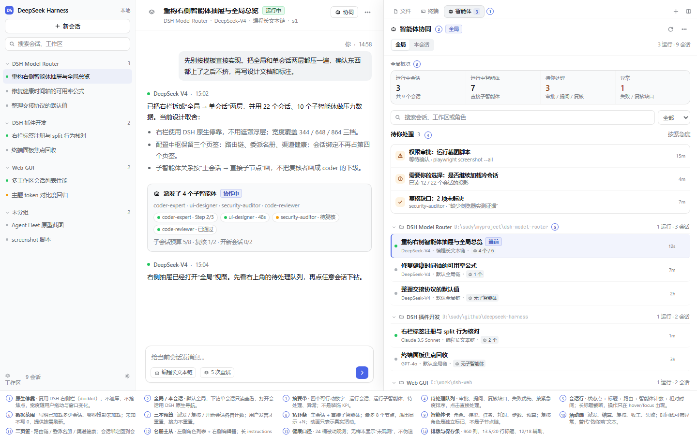
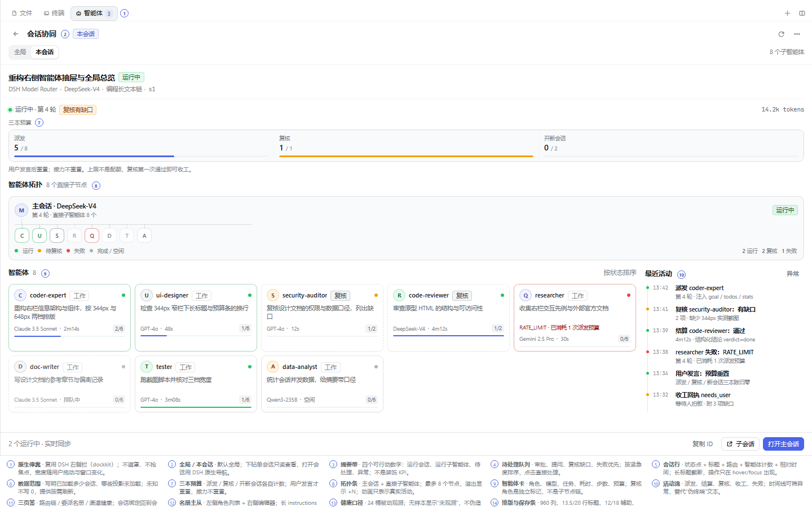
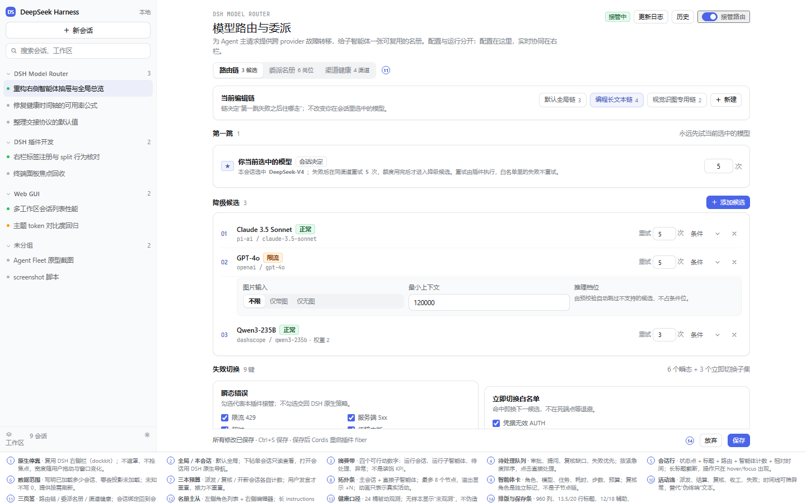
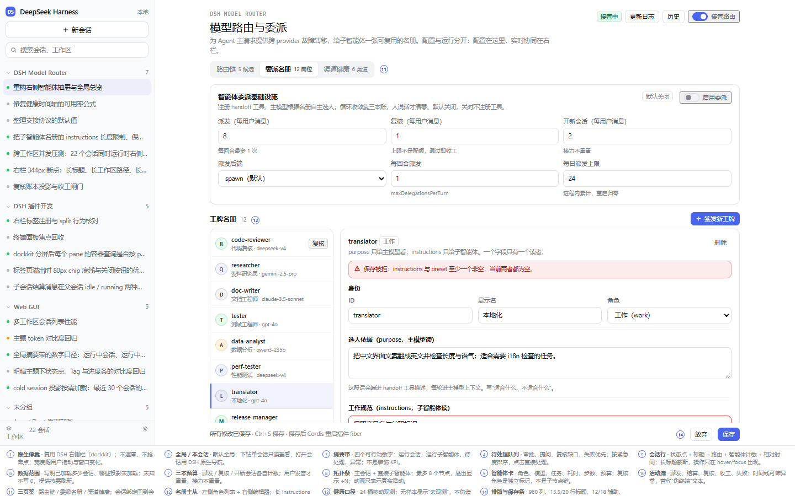
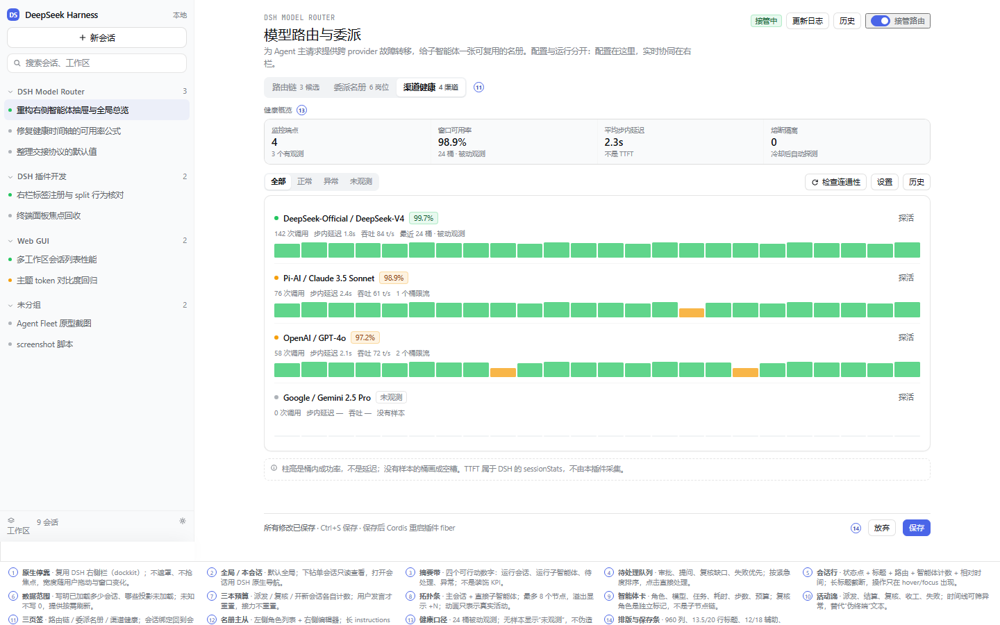

# Agent Fleet 右栏与三页签配置中枢

## 摘要

本页定义 DSH Model Desk 的目标界面：**主列做配置，右栏做运行**。

- 主列仍是 960 列、吸顶页头/页签、吸底保存条；一级页签收敛为 **路由链 / 委派名册 / 渠道健康** 三个。会话绑定回到会话输入框的 chip，故障转移历史留在 Modal，不再占一级页签。
- 右栏是一个 **DSH dockkit 标签页**，不是 `fixed` 抽屉。默认显示**全局**：跨工作区、跨会话的运行中会话、子智能体、待处理事项和异常；点任意会话下钻到**单会话**，看到主会话 → 直接子节点、三本预算、活动流与可执行动作。
- 右栏第一阶段只用 DSH 现有数据（会话列表、工作区、`subagentCatalog`、`subagentTiming`、`tokenUsage`、`SessionStatus`），不改宿主；委派名册、复核账本与收工回执属于 handoff 提案的第二阶段。
- 设计真值是本页的 **D1–D11 / C1–C3 / T1–T2 / A1–A2** 编号与“验收锚点”，原型截图只是视觉快照。实施偏离按 §9 记录，不允许静默改口径。

模板审查见 [Gemini 模板审查](ui-review-gemini-template.md)；可交互原型见 [`docs/prototypes/agent-fleet.html`](../prototypes/agent-fleet.html)。

## 一、先划清事实、提案与新能力

| 区块 | 状态 | 依据 |
|---|---|---|
| 右栏 dockkit 标签页（全局 + 单会话） | **提案**，数据已具备 | `sidebarRightTabs` / `sidebar.right.pane.tab`；`subagentCatalog` / `subagentTiming` / `tokenUsage` / `SessionStatus` |
| 三页签配置中枢（路由 / 名册 / 健康） | **提案**；路由与健康已实现，名册待 handoff | 当前 `RouterPage` 只有两视图（[`page.ts:37-38`](../../packages/dsh-model-desk/src/client/page.ts#L37)） |
| 名册、三本预算、收工回执 | **提案**；需 handoff 宿主能力 | [handoff-proposal.md](handoff-proposal.md) §4–§8 |
| 复核账本 / 失败的子智能体 | **需新增投影** | 当前 client 只有 `subagentCatalog` / `subagentTiming`，没有“失败”状态 |
| Nudge 按钮 / 手动熔断 / 导出审计 | **不做（v1）** | 没有宿主动作或数据源；不要用 `alert()` 假装修好 |
| 标签页宽度、自动全屏、标签条 | **已核实** | DSH 右栏与 dockkit；见 §4.2 |

## 二、设计原则

1. **两个时间尺度分开。** 配置低频、写、需要空间，放主列；运行高频、读、需要常驻，放右栏。右栏不重复配置入口。
2. **全局优先，单会话下钻。** 打开先看“所有工作区现在在跑什么”；点一行才进入一个会话。单会话对其他会话只读。
3. **只用原生载体。** 注册 `sidebarRightTabs` 类型 + `sidebar.right.pane.tab` 正文；不自建浮层、不复刻标签条、不加遮罩。
4. **一张图只表达一种关系。** 主会话 → 直接子节点；复核是角色与账本状态，不画成 coder 的下级。
5. **未知不是 0。** 投影缺失写“未知/未加载”；列表失败写错误，不画空列表；没有样本的健康桶画空槽。
6. **密度靠断点，不靠缩小字号。** 344 单列、648 两列、≥700 双列、全屏 920 阅读列；文字最小 10.5px，关键元数据 11.5–12px。
7. **动效只表示活动。** 只有运行中的节点/边动；列表不逐行呼吸；尊重 `prefers-reduced-motion`；标签隐藏时暂停。
8. **可访问性是结构问题。** 原生 tabs/按钮、键盘、焦点、状态文字、对比度，不靠“看起来还行”。

### 2.1 规格编号

实施、测试和偏离记录都引用这些编号；编号只增不改，改语义就换新号。

| 编号 | 规格 |
|---|---|
| D1 | 右栏载体：dockkit 标签页，不浮层、不遮罩 |
| D2 | 全局默认；单会话下钻；其他会话只读 |
| D3 | 全局摘要带（四个数） |
| D4 | 待处理队列 |
| D5 | 工作区分组 + 会话行 |
| D6 | 数据范围、未知/空/错误状态 |
| D7 | 三本预算 |
| D8 | 主会话 → 直接子节点拓扑 |
| D9 | 智能体卡 |
| D10 | 活动流 |
| D11 | 动效语义 |
| C1 | 路由链页 |
| C2 | 委派名册页（P2） |
| C3 | 渠道健康页 |
| T1 | 排版尺度 |
| T2 | 尺寸、间距与容器断点 |
| A1 | 键盘、焦点、语义角色 |
| A2 | 对比度、状态文字、非颜色表达 |

## 三、信息架构

```text
会话输入区 chip（当前会话）
  └─ 模型路由：当前链 / 重试覆盖（写）

主列：配置中枢（960 列）
  ├─ 路由链        第一跳 / 降级候选 / 失败切换 / 输出续跑 / 会话绑定说明
  ├─ 委派名册      handoff 总闸 / 三本预算 / 名册列表 + 编辑器 / 收工闸门
  └─ 渠道健康      24 桶观测 / 过滤 / 探活与设置 / 历史 Modal

右栏：智能体协同（dockkit 标签页，按会话）
  ├─ 全局（默认）  摘要 / 待处理 / 工作区分组 / 会话行 / 数据范围
  └─ 单会话（下钻） 会话头 / 三本预算 / 拓扑 / 智能体卡 / 活动流 / 动作

Modal：故障转移历史 / 添加候选 / 健康设置 / 删除确认 / 工牌子编辑（如需）
```

### 3.1 功能分配矩阵

| 功能 | 主位置 | 次位置 | 读写 | 说明 |
|---|---|---|---|---|
| 链路、候选、失败切换、预算 | 配置中枢·路由链 | 会话 chip 只改绑定 | 写 | 右栏只读显示链名，不放编辑 |
| 当前会话绑定的链 / 重试覆盖 | 会话输入区 chip | 右栏单会话只读 | 写 | 与 DSH 原生位置一致，不另开页签 |
| 名册、handoff 开关、闸门、三本预算 | 配置中枢·委派名册 | 右栏显示预算使用量 | 写 | 名册是“菜单”，不是运行状态 |
| 渠道健康设置、熔断规则 | 配置中枢·渠道健康 | 健康设置 Modal | 写 | 规则不藏第二层子弹窗 |
| 实时渠道观测 / 24 桶 | 配置中枢·渠道健康 | 故障转移历史 Modal | 读 | 右栏不重复渠道健康 |
| 故障转移历史 | Modal | 健康页工具组 | 读 | 最近 20 个会话投影；不做自建抽屉 |
| 全局运行摘要 / 待处理 | **右栏·全局** | 左栏会话状态点 | 读 | 跨工作区、跨会话 |
| 单会话子智能体拓扑 / 活动流 | **右栏·单会话** | 会话 header lineage | 读 | 打开子会话走原生导航 |
| 收工回执 / 复核账本 | 右栏·单会话 | 会话轨迹 / notice | 读 | 第二阶段；需要新投影 |
| 更新日志 / 版本 | 配置中枢页头 | — | 读 | 不占页签 |

**结论**：不设第 4 个“会话透视”页签；会话绑定在 chip，运行在右栏，历史在 Modal。

## 四、右栏：Agent Fleet

### 4.1 载体与打开方式

| 项 | 规格 |
|---|---|
| 类型注册 | `ctx.sidebarRightTabs.register({ id, kind: 'agent-fleet', priority: 'extension', title, guide })`；`multiple: false`，一个会话一个页面 |
| 正文 | `sidebar.right.pane.tab` keyed by `id`；标题可选 `sidebar.right.pane.tab.title` |
| 打开 | guide entry（`title: 智能体协同`，`description: 跨工作区查看子智能体状态`）+ 可选快捷键；`openTab` 会同步展开右栏（[`service.ts:197-216`](file:///D:/sudy/github/deepseek-harness/packages/client/ui-sidebar-right/src/client/service.ts#L197)） |
| 不添加 | 会话头按钮（原生展开按钮已存在）、自绘关闭/全屏按钮、遮罩、`position: fixed` |
| 状态 | `keepMounted: false`；视图选择通过导航参数保存，重新打开回到上次的全局/会话 |

打开的代码形状（伪代码，实施时按当前 Loader 组合校验）：

```ts
ctx.sidebarRightTabs.register({
  id: 'dsh-model-desk/fleet',
  kind: 'agent-fleet',
  priority: 'extension',
  title: () => t('fleet.tab'),
  guide: [{ id: 'fleet', order: 40, title: () => t('fleet.guide'), description: () => t('fleet.guideHint') }],
})
ctx.slots.inject('sidebar.right.pane.tab', () => ctx.slots.register(
  { name: 'sidebar.right.pane.tab', key: ID, locale: NS, inject: () => ({ sessions, status, workspaces }) },
  FleetBody,
))
```

### 4.2 尺寸、断点与容器

DSH 右栏宽度由列求解器决定，不能用 `vw` 写死。右栏宽度是**按像素记忆的用户偏好**，求解器用 `available = viewport − 左栏 − 400` 封顶；下面第一组是“首次打开、45% 默认比”，第二组是同一台机器把右栏在 1440 拖开后（记忆 648）再缩窗口的实测值——两者都正确，别把任一组当成唯一真值：

| 视口 | 左栏 | 右栏（首次打开 45%） | 右栏（记忆 648） | 中间列 | 页面形态 |
|---|---|---|---|---|---|
| 1440 | 280 | 648 | 648 | 512 | 停靠 |
| 1280 | 280 | 576 | 600 | 424 / 400 | 停靠 |
| 1024 | 280（展开）或 56（收起） | 461 | 344（展开）/ 569（收起） | 400 起 | 停靠 |
| 800 | 56（打开右栏时自动收起） | 344 | 344 | 400 | 停靠 |
| < 768 | — | 视口宽 | 视口宽 | — | 自动全屏 |

依据：[`columns.ts:11-29`](file:///D:/sudy/github/deepseek-harness/packages/client/ui-layout/src/client/columns.ts#L11)、[`SidebarRight.tsx:360-370`](file:///D:/sudy/github/deepseek-harness/packages/client/ui-sidebar-right/src/client/shell/SidebarRight.tsx#L360)、[`AppFrame.tsx:160-173`](file:///D:/sudy/github/deepseek-harness/packages/client/ui-layout/src/client/AppFrame.tsx#L160)。1024 是临界点：视口 `< 1024` 时打开右栏会把左栏收起；正好 1024 不会。**不要把 1024 当成固定 568 的右栏**。

2026-10-23 在桌面 `0.2.1-rc.2` 运行时实测（隔离 home，右栏先在 1440 打开）：1440→648、1025 左栏展开→345、1025 左栏收起→569、801→345、全屏→1020（内层阅读列 920）。旧表的“1024 收起 461”是 45% 反推值，不是记忆宽度下的结果。

右栏宽度是用户可拖动的：DSH 原生在右栏左缘有 drag handle，范围 300–70% 视口且中间列保底 400。原型里的拖动柄只是模拟这个原生行为，实施时不要再建一套。全屏时宽度为视口宽，拖动柄不出现。

标签条由 dockkit 提供：28px 高 + 10px 上内边距（[`dockkit.module.css:237-248`](file:///D:/sudy/github/deepseek-harness/packages/client/ui-dockkit/src/components/dockkit.module.css#L237)）。正文不再画第二层标题栏。

**必须用容器查询，不用视口查询**，因为右栏可拖动，分屏后每个 pane 的宽度也不同：

| 容器宽度 | 布局 |
|---|---|
| ≤ 430 | 摘要 2×2；会话行只留模型 + 智能体数；动作条换行；隐藏工作区路径 |
| 431–699 | 摘要 4 列；智能体单列；活动流在下方 |
| ≥ 700 | 智能体 + 282px 活动流双列；拓扑右侧显示计数；全局列最大 920px |

### 4.3 全局视图（D3–D6）



**头部（44px，sticky）**：标题“智能体协同” + 范围分段“全局 / 本会话” + 刷新/更多。范围切换不丢滚动位置；从单会话返回全局回到原来的分组位置。

**摘要带（D3）**：四格，不是装饰 KPI：

| 格 | 口径 | 数据缺失时 |
|---|---|---|
| 运行中会话 | `SessionSummary.running` / `useSessionStatus` | `—` + 读取失败 |
| 运行中智能体 | 已加载 catalog 中 `running` 的直接子节点；只统计已加载会话 | `—`；副行写“N 个会话未知” |
| 待你处理 | `pendingInteraction` 的 approval / plan-review / question | `—` |
| 异常 | 插件账本的失败 / 复核缺口；第一阶段可把 `lastTurnCompleted === false` 标成“未正常完成” | `—` |

待处理取 `SessionStatus.pendingInteraction` 的 `approval` / `plan-review` / `question`（[`tree.ts:379-388`](file:///D:/sudy/github/deepseek-harness/packages/client/ui-workspace/src/client/tree.ts#L379)）。子会话的 `subagentTiming` 按子会话 id 从 `projectionsBySession[childId]` 读取；父会话的 `useProjection` 只提供父会话自己的投影。

**待处理队列（D4）**：审批、提问、复核缺口、失败优先；按紧急度排序；最多显示 4 条 + “还有 N 个”，点击进入对应会话。数量口径与摘要一致，不能出现“摘要 6、列表 4”却不说明。

**搜索与筛选（D5）**：搜索标题/工作区/模型/角色；筛选“全部 / 运行中 / 待处理 / 异常”。搜索只过滤已加载列表，不触发新的 RPC 风暴。

**工作区分组（D5）**：
- 组头 sticky：折叠箭头、工作区名、路径（窄栏隐藏）、`N 运行 · M 会话`。
- 会话行 48px：状态点 + 标题（单行省略）+ 模型/链/子智能体计数 + 相对时间 + 打开。
- 运行中排前，其余按更新时间；当前会话用左侧 2px accent 条和浅底。
- 长标题、长工作区名、英文长模型名都必须省略；不能把行撑高。
- 行本身只有一个点击面；尾部“打开会话”是独立按钮，键盘可分别到达。

**数据范围（D6）**：底部一句“已加载最近 N 个会话的子智能体状态；M 个未加载，显示为未知”。提供刷新；不把“未加载”写成 0。

**全局状态**：空（没有会话）、错误（列表读取失败，摘要显示 `—`，不画 0）、部分数据（未知 + 加载）、无匹配（搜索/筛选为空）。原型里的空/错/未知三态见 `proto-08/09/10`。

### 4.4 单会话视图（D7–D10）



**会话头**：返回全局、标题、状态、工作区/模型/链/会话 id；右上“打开主会话”。其他会话只读，不出现配置开关。

**三本预算（D7）**：派发 / 复核 / 开新会话，各自“已用 / 上限”+ 细进度条；下方一句“人一说话就重置；接力不重置；上限不是配额”。已用 = `router/handoff` 投影计数 + 账本里接力带来的计数（`addCarried` 一个表达式，闸门与界面共用）；上限来自浏览器自己那份配置。投影未加载、接力计数还没读回、或 handoff 关着时**整块隐藏**，不显示假数字。

**拓扑条（D8）**：
- 根节点是**本会话主智能体**，不是虚构的“主控脑”。
- 只画直接子节点（`subagentCatalog`），最多 8 个 + `+N`；不做自由力导向布局。
- 状态：运行（绿）/ 待复核（琥珀）/ 失败或未完成（红）/ 完成或空闲（中性）；复核用文字标签与虚线卡，不用紫色。
- 动画：运行节点一个缓慢脉冲；活动边一个流动点；完成/空闲不动。
- 读屏摘要：“主会话运行中，8 个直接子智能体，2 个运行，2 个复核，1 个失败”。

**智能体卡（D9）**：角色 id、角色标签（工作/复核）、模型、任务（2 行省略）、耗时、步数、本角色预算、进度。失败卡显示错误码与“已消耗 N 次派发”，不显示伪造的终端命令。
- 排序：运行中 → 待复核 → 失败 → 完成 → 空闲；同状态按开始时间。
- 卡片是按钮，打开子会话；尾部“在侧栏打开”是独立动作，不嵌套在按钮里。

**活动流（D10）**：行是**模型自己写下的回执**，来自 `router/handoff` 投影的 `records`——派发（带角色 id）/ 收工（带 outcome）/ 开新会话 / 读事实，时间 + 类型 + 对象，最新在前。复核是一次派给 `review` 角色的委派，按派发行显示；「结算」与「失败」需要子智能体结算事件，投影不折叠它，因此不出现（见 §9.3 的 F-21）。没有事件投影时显示“活动流尚未接入”，投影在但为空显示“还没有派发或收工记录”，都不画空时间线、不拿伪终端文本充数。

**动作条**：复制会话 ID、打开子会话、打开主会话。v1 不做 Nudge / 停止 / 熔断，因为没有宿主动作；不要用 `alert()` 假装。

### 4.5 状态与空态（D6）

| 状态 | 表现 |
|---|---|
| 加载中 | 骨架屏在摘要/列表位置；不显示 0 |
| 空（无会话） | “还没有可显示的会话”，说明不会用空图表冒充正常 |
| 空（本会话无子智能体） | “本会话还没有派发子智能体”，不是错误 |
| 投影未知 | 行内“智能体未知 + 加载”；摘要副行写“N 个会话未知” |
| 列表失败 | 错误卡 + 重试；摘要 `—`；标签徽标 `!` |
| 部分加载 | 已加载行正常，未知行保留；底部说明范围 |
| 无匹配 | 清搜索/筛选提示 |
| 只看其他会话 | “其他会话 · 只读”提示；动作只有打开 |

## 五、配置中枢：三页签（C1–C3）



### 5.1 页签与保存

- 页签：`路由链` / `委派名册` / `渠道健康`；数量在标签内，用 10px 数字，不加 emoji。
- 页头：20/28 标题、接管 Switch、更新日志、历史。
- 内容：960 列、页头与页签同一 sticky 行、保存条吸底；与现有 [工作台布局重构](ui-layout-redesign.md) 一致。**页头、页签、正文、页脚共用同一条 960 列，大屏不得各自加水平 padding**；否则 1440 下正文居中、页头贴左，小屏反而看起来正常。
- 委派名册是 P2 页签：P1 只保留路由/健康；P2 上线后，即使 handoff 关着也显示该页签，内容为激活卡 + 空态，不注册工具、不出现假名册。
### 5.2 路由链（C1）

- 第一跳独立一行：本会话选中的模型 + 失败后同渠道重试；不与候选混排。
- 降级候选：扁平行，序号、显示名、物理路由、健康 Tag、重试、权重、条件、上下移/删除；不再卡片套卡片。
- 失败切换：瞬态错误 + 立即切换白名单两栏；复选框用原生控件。
- 每条候选的重试次数在行内配置；第一跳的重试只在上方第一跳行配置一次。**没有单独的“单请求最多调用”配置**，那是把每条候选的额度又抄一遍的第二真相源。
- 输出续跑单独一行：撞到 max-tokens 时自动 steer 继续，最多 N 次；续满仍截断才换下一条候选。
- 会话绑定：链绑定在输入框 chip；重试次数有两个入口——链行上的默认值、chip 里的本会话覆盖（留空跟随链）。同一概念的两个作用域，不删掉任何一个，也不隐藏其中一个。

### 5.3 委派名册（C2）



- 顶部：handoff 总闸（默认关）+ 三本预算（派发 8 / 复核 1 / 新会话 2，均可配）+ 每回合派发 1 / 每日 24；派发后端 `spawn`。每回合追问上限放在收工闸门，避免顶部与闸门各有一个入口。
- 主体：224px 角色列表 + 编辑器。
  - 列表最大高 420px，独立滚动；选中项始终滚进可视区；12 个角色不把页面撑爆。
  - 编辑器分区：身份（id / 显示名 / 角色）、purpose（主模型读）、instructions（子智能体读，≤4000 字符）、运行（preset / provider / model / reasoningEffort / maxTokens / failover / maxRunsPerUserMessage / outputSchema）、备料（goal/todos/userRequest/stats）。
  - 校验摘要置顶（红底一行），不把错误埋在 textarea 下方；保存被拒时同时保留字段级红框。
  - “purpose 只给主模型看；instructions 只给子智能体；一个字段只有一个读者”作为常驻 hint。
- 协议与接力：一个 handoff 工具四个动作（`delegate` / `finish` / `newSession` / `facts`；前三个可关，`newSession` 随接力配置）。接力配置：`onFinish`（done/needs_user/abandoned，默认空）、`nextAction`（continue / review / review-then-continue）、`briefing`（goal/todos/userRequest/lastReview/stats）、`keepGoal` / `carrySelection` / `carryChainBinding`。这部分与“收工闸门”分开：前者是工具与接力，后者是拒绝条件。
- 收工闸门与兜底：`requireReviewFor`（done/needs_user/abandoned，默认空）、`allowReviewOverride`（默认开）、`nudgeWhenUnreceipted`（默认关）、`maxNudgesPerTurn`（1）、`delegateTo`（默认空，只报告）、`reportToUser`（默认开）。默认值必须来自 [handoff-proposal.md](handoff-proposal.md) §十二，不在 UI 里另设一套。

**handoff 默认值（单源：提案 §5 / §12）**

| 字段 | 默认 | UI 位置 |
|---|---|---|
| `enabled` | false | 顶部总闸 |
| `subagentBackend` | spawn | 顶部 |
| `protocol.delegate` / `finish` / `facts` | true / true / true | 工具动作 |
| `protocol.requireReviewFor` | [] | 收工闸门 |
| `protocol.allowReviewOverride` | true | 收工闸门 |
| `limits.maxDelegationsPerTurn` | 1 | 顶部 |
| `limits.maxDelegationsPerUserMessage` | 8 | 顶部（三本账之一） |
| `limits.maxReviewsPerUserMessage` | 1 | 顶部（三本账之一） |
| `limits.maxNewSessionsPerUserMessage` | 2 | 顶部（三本账之一） |
| `limits.nudgeWhenUnreceipted` | false | 收工闸门 |
| `limits.maxNudgesPerTurn` | 1 | 收工闸门 |
| `onUnreceiptedStop.delegateTo` | ""（只报告） | 收工闸门 |
| `onUnreceiptedStop.reportToUser` | true | 收工闸门 |
| `newSession.onFinish` | [] | 接力 |
| `newSession.nextAction` | continue | 接力 |
| `newSession.briefing` | goal/todos/userRequest/lastReview/stats | 接力 |
| `newSession.keepGoal` / `carrySelection` / `carryChainBinding` | true / true / true | 接力 |
| `roster[].purpose` | 必填 | 名册编辑器 |
| `roster[].instructions` | ""（≤4000 字符；与 preset 至少一个非空） | 名册编辑器 |
| `roster[].maxRunsPerUserMessage` | 名册配置 | 名册编辑器 |

### 5.4 渠道健康（C3）



- 顶部 KPI：监控端点 / 窗口可用率 / 平均步内延迟 / 熔断隔离；注明“不是 TTFT”。
- 过滤：全部 / 正常 / 异常 / 未观测；工具组：检查连通性、设置、历史。
- 行：状态点 + 名称 + 可用率 Tag + 样本量 + 步内延迟 + 吞吐 + 探活；24 桶柱高=桶内成功率，空槽=无观测。
- 桶长可选 1/5/10/30/60 分钟；图例只说一次，不逐行重复。
- 不显示 TTFT、全局“存活率”、手动熔断；这些没有插件数据源。

## 六、数据契约

### 6.1 数据源与缺口

| 界面 | 客户端来源 | 可用性 | 缺失时 |
|---|---|---|---|
| 工作区 / 会话列表 | `useWorkspaces` + `useSessions`（[`ui-workspace/index.ts:71-77`](file:///D:/sudy/github/deepseek-harness/packages/client/ui-workspace/src/client/index.ts#L71)、[`service.ts:27-66`](file:///D:/sudy/github/deepseek-harness/packages/api/session-controller/src/client/sessions/service.ts#L27)） | 始终 | 错误卡，不画 0 |
| 运行状态 / 待处理 | `useSessionStatus`（[`ui-session/index.ts:59-72`](file:///D:/sudy/github/deepseek-harness/packages/client/ui-session/src/client/index.ts#L59)） | 始终 | 未知 |
| 直接子智能体 | `projectionsBySession[id].values.subagentCatalog`（[`projection-types.ts:10-38`](file:///D:/sudy/github/deepseek-harness/packages/subagent/subagent/src/projection-types.ts#L10)） | 可能未加载 | 显示“未知”+ 加载 |
| 子智能体耗时 | `subagentTiming.active.since` / `settledMs` / `lastTurnCompleted` | 可能未加载 | `—` |
| Token | `tokenUsage` 投影（[`projection.ts:68-76`](file:///D:/sudy/github/deepseek-harness/packages/llm/token-meter/src/projection.ts#L68)） | provider 上报时 | 整格隐藏 |
| 复核 / 收工 / 活动流 | 插件自有 `router/handoff` 投影的 `records`（`handoff.ts` 的 `handoffProjection`） | 插件 fiber 已加载时；可能未加载 | 未加载写“活动流尚未接入”；已接入但没有回执写“还没有派发或收工记录”；都不画空时间线 |
| 三本预算 | 投影计数（`router/handoff` 的 `records`）+ 账本里接力携带的计数（`deskHealth.handoffCarried` 只回答这一半） | 投影可能未加载；carried 读一次后缓存 | 任何一半未知就整块隐藏；不显示假数字 |
| 失败的子智能体 | 插件账本；`lastTurnCompleted === false` 只能标“未正常完成” | **需新增/谨慎** | 不写“失败” |
| 打开子会话 | `ctx.sidebarRight.openResource(subagentChatAddress(address), { kind: 'subagentchat' })`（[`ui-subagent/index.ts:60-72`](file:///D:/sudy/github/deepseek-harness/packages/client/ui-subagent/src/client/index.ts#L60)） | 始终 | 只打开主会话 |

### 6.2 加载策略

1. 首屏只读会话列表 + 工作区 + 状态；不做 per-session 投影风暴。
2. 再按“可见 + 最近活跃”加载最近 20 个会话的投影；并发 4；缓存按会话 id。
3. 未知行保留；用户点“加载”或打开会话时 `refreshProjections(id)`（[`contract/sessions.ts:101-106`](file:///D:/sudy/github/deepseek-harness/packages/api/session-controller/src/client/contract/sessions.ts#L101)）。
4. 右栏隐藏/卸载时停止调度并忽略迟到结果；不 `retain` 每个会话。`refreshProjections(sessionId): Promise<void>` 没有 AbortSignal（[`contract/sessions.ts:101-106`](file:///D:/sudy/github/deepseek-harness/packages/api/session-controller/src/client/contract/sessions.ts#L101)），已派发 Host 读不能 abort；实现是 controller 的 `pause()/resume()`，不是取消在飞请求。
5. 超过 20 个显示“已加载 X / Y”，不做无限滚动。

### 6.3 口径纪律

- **未知 ≠ 0**；没有样本的健康桶画空槽；错误摘要写 `—`。
- **运行中子智能体**只统计已加载 catalog；摘要必须带“N 个未知”。
- **异常**分两级：第一阶段只能说“最近回合未正常完成”；有 handoff 账本后才说“失败”。
- **Token** 是 provider 上报的累计值，不是费用；没有上报就不显示。
- **预算** 是插件账本，不是会话事件；用户发言才重置，接力不重置。
- **复核** 是角色 + 账本，不是父子关系；不要把 reviewer 画成 coder 的子节点。

## 七、视觉规格

### 7.1 排版

| 角色 | 字号 / 行高 | 字重 | 备注 |
|---|---|---|---|
| 配置页标题 | 20 / 28 | 500 | 与 DSH 面板页一致 |
| 分区标题 | 12 / 18 | 600 | 右栏用；配置页可用 14/20 |
| 会话/行标题 | 12 / 17.5 | 550 | 窄栏省略，不换行 |
| 任务/正文 | 12 / 18 | 400 | 右栏任务 2 行截断 |
| 辅助元数据 | 11.5 / 16 | 400 | 模型、链、时间 |
| 标签 / 计数 | 10.5 / 16 | 500 | 10px 只用于标签内数字 |
| 等宽 | 10–11 / 16 | 400 | 路由、会话 id、桶时间 |
| 数字 | tabular-nums | — | 预算、计数、时间 |

### 7.2 尺寸与间距

| 项 | 值 |
|---|---|
| 配置列宽 | 960px，页面自己滚动 |
| 右栏全局列 | 最大 920px，居中；窄栏自然满宽 |
| 右栏正文内边距 | 14px；窄栏 10px |
| 标签条 | dockkit 28px + 10px 顶距 = 38px |
| 右栏头部 | 44px；范围行 26px |
| 会话行 | 48px；分组头 28px |
| 卡/面板圆角 | 8 / 10 / 12 |
| 边框 | 0.5px；分隔线 0.5px |
| 动作条 | 44px，吸底；窄栏换行 |
| 点击目标 | 最小 24px；图标按钮 26–28px |

### 7.3 颜色

- 强调：插件 accent `#4A65E8`；只用于选中、链接、主按钮。
- 状态：绿（运行/通过）、琥珀（等待/缺口）、红（失败/危险）、中性（完成/空闲）。
- **不引入紫色**：复核是角色，不是状态；用文字标签 + 虚线边框。
- 明暗主题只读 DSH token；不写死 `rgb()` 背景；不模仿霓虹/激光。
- 对比度目标 AA；状态点旁必须有文字。

### 7.4 动效（D11）

- 运行节点：一次 2.4s 的轻脉冲；活动边：1.8s 流动点。
- 列表不逐行脉冲；同一视图最多 2 个持续动画元素。
- 只动 `transform` / `opacity`；不动布局。
- `prefers-reduced-motion: reduce` 全部关闭；`document.visibilityState === 'hidden'` 暂停。
- 动画不表达“健康/成功”，只表达“有活动”。

### 7.5 可访问性（A1–A2）

- 范围切换用 DSH `SegmentedTabs`/`SegmentedControl`，有 `role=tab`、`aria-selected`、方向键。
- 会话行是单一按钮/链接；尾部动作是独立按钮，不嵌套可交互元素。
- 拓扑提供 `aria-label` 摘要；状态不只靠颜色。
- 焦点可见；打开/返回后焦点回到触发元素。
- 英文/中文都测窄栏：英文标签更长，必须省略。
- 图标用 SVG，不用 emoji 作为唯一语义。

## 八、实施映射

| 步骤 | 落点 |
|---|---|
| 1. 注册标签类型 | `ctx.sidebarRightTabs.register`（[`tab-registry.ts:94-139`](file:///D:/sudy/github/deepseek-harness/packages/client/ui-sidebar-right/src/client/tab-registry.ts#L94)）；`id` 用包名，`kind: 'agent-fleet'`，`priority: 'extension'` |
| 2. 注册正文 | `sidebar.right.pane.tab` keyed by id（[`contract/slots.ts:59-78`](file:///D:/sudy/github/deepseek-harness/packages/client/ui-sidebar-right/src/client/contract/slots.ts#L59)）；标题可选 |
| 3. 导航参数 | 扩展 `SidebarRightTabParamsMap`：`{ view: 'global' \| 'session'; sessionId?: SessionId }`；默认 global |
| 4. 打开入口 | guide entry；`ctx.sidebarRight.openTab('agent-fleet')`；可选快捷键。不要加会话头按钮 |
| 5. 全局数据 | `useSessions` + `useSessionStatus` + `useWorkspaces`；按需 `refreshProjections` |
| 6. 单会话 | `useProjection('subagentCatalog')` / `useProjection('subagentTiming')`；子会话摘要从 `sessions.list.byId` 取 |
| 7. 打开动作 | `ctx.uiWorkspace.openSession(...)`；子会话侧栏用 `ctx.sidebarRight.openResource(subagentChatAddress(...), { kind: 'subagentchat' })` |
| 8. 配置页第三页签 | handoff host 落地后加；此前只保留路由/健康，避免空壳 |
| 9. 样式 | CSS Modules 或注入样式；容器查询；禁止 `position: fixed` 抽屉 |
| 10. 测试 | 真实 Loader 组合 + 1440/1024/800/全屏 + 22 会话压力 + 明暗主题 + 键盘 |

**分期**：

- **P1（可先做）**：右栏 tab + 全局/单会话，使用现有会话与 `subagentCatalog`；不改宿主。配置页保持两个页签；名册入口暂不展示。
- **P2**：handoff 名册 + 三本预算 + `router/handoff` 投影 + 第三页签；收工回执/复核账本。
- **P3**：活动流细化、审计导出（若届时确有数据源）、更多干预动作（若宿主提供契约）。

**2026-10-23 P1 落地**：`client/fleet/` 注册了 `dsh-model-desk` / `agent-fleet` 类型与 `sidebar.right.pane.tab` 正文；全局/单会话、最近 20 并发 4、未知/空/错误/无匹配、紧凑拓扑、920 全屏列与 reduced-motion 守卫均已实现。分组头用 DSH `DisclosureRow`，长标题/任务用 DSH `Tooltip`（不再自绘折叠按钮、不再靠原生 `title`）；调度由 `tab.visible` 驱动，隐藏即 `pause()`（F-06）；拓扑有共享导轨与首个运行子节点的 1.8s 流动点（F-04）。配置页输出续跑独立分区、候选/第一跳各自保留重试输入、删除总调用数字、chip 保留链绑定与 per-route 覆盖。P2 仍按 §10.1 等待 host。

## 九、原型、标注与偏离记录

### 9.1 原型

- 文件：[`docs/prototypes/agent-fleet.html`](../prototypes/agent-fleet.html)
- 原型按 **P1 + P2 的目标形态** 绘制（含第三页签与名册）；P1 实施时只保留路由/健康两个页签，右栏不受影响。
- 所有截图可用 URL 复现：`?screen=drawer|console&scenario=normal|stress|partial|empty|error&theme=light|dark&width=1440|1280|1024|900|800|full&session=s1&tab=chain|roster|health&anno=1&chrome=0&popover=1&scroll=bottom&right=300..760`
- 截图目录：[`docs/assets/ui/`](../assets/ui/)

| 文件 | 场景 |
|---|---|
| `proto-01-global-light.png` | 1440 全局，常规 |
| `proto-02-global-stress-dark.png` | 1440 全局，22 会话，深色 |
| `proto-03-session-full-light.png` | 全屏单会话，8 个智能体 |
| `proto-04-session-800-light.png` | 800 视口 / 344 右栏单会话 |
| `proto-05-console-chain-light.png` | 路由链页 |
| `proto-06-health-light.png` | 健康页 |
| `proto-07-roster-stress.png` | 12 角色、校验拒绝 |
| `proto-08-empty-light.png` | 空 |
| `proto-09-error-light-1024.png` | 列表失败，1024 |
| `proto-10-partial-light.png` | 投影未知 |
| `proto-11-global-full-stress.png` | 全屏全局，920 列 |
| `proto-12-session-1024-light.png` | 1024 单会话（左栏展开，右栏约 344） |
| `proto-13-session-retry-popover.png` | 会话 chip 的重试覆盖入口（与链行同概念） |
| `proto-14-roster-gates.png` | 名册底部：协议、接力、收工闸门 |
| `proto-15-session-dragged-760.png` | 右栏拖到 760px，中间列保底 400 |

### 9.2 标注索引

| 编号 | 主题 | 对应规格 |
|---|---|---|
| A1 | 原生停靠，不是浮层 | D1 / §4.1 |
| A2 | 全局 / 本会话 | D2 / §4.3 |
| A3 | 摘要带四个可行动数字 | D3 / §4.3 |
| A4 | 待处理队列 | D4 / §4.3 |
| A5 | 会话行与分组 | D5 / §4.3 |
| A6 | 数据范围，未知不写 0 | D6 / §4.5 |
| A7 | 三本预算 | D7 / §4.4 |
| A8 | 拓扑条（直接子节点） | D8 / §4.4 |
| A9 | 智能体卡 | D9 / §4.4 |
| A10 | 活动流 | D10 / §4.4 |
| A11 | 三页签 | C1 / §5.1 |
| A12 | 名册主从 + 校验置顶 | C2 / §5.3 |
| A13 | 健康 24 桶与样本量 | C3 / §5.4 |
| A14 | 排版与吸底保存条 | T1/T2 / §7 |

### 9.3 偏离记录

**真值顺序**：本页编号与验收锚点 > 原型截图 > 实施中的口头决定。截图是快照，不是像素规格；允许 2px 级别的实现差异，但不允许改载体、作用域、关系模型、数据口径。

任何实施偏离先填下表，再改代码；涉及硬约束的，先写决策笔记并让用户确认：

| ID | 日期 | 原条款 | 实际做法 | 原因 | 证据 | 状态 |
|---|---|---|---|---|---|---|
| F-01 | 2026-10-23 | §4.1 标签类型 `id` 用包名 | `id: dsh-model-desk`，`kind: agent-fleet`，正文/标题 key 同 id | 包名是 registry 的自然唯一身份；正文 key 必须与类型 id 相同 | `client/fleet/index.ts`；`tab-registry.ts:94-139` | 已落地 |
| F-02 | 2026-10-23 | §4.3 会话行显示“模型/链/子智能体计数” | 链名只在当前会话或已下钻会话读取并显示；其他行省略 | 每个会话的链绑定是插件自有 Remote；首屏 20 行逐个读会形成 RPC 风暴，违反 §6.2 | `client/fleet/controller.ts` 的 `loadBinding`；`src/index.ts:726-734` | 已落地 |
| F-03 | 2026-10-23 | §4.4 D9 智能体卡含步数、预算、进度 | 卡片显示状态、模型、任务、耗时、Token；无步数/预算/进度，缺失即隐藏 | `subagentTiming` 只有 `settledMs`/`active`/`lastTurnCompleted`；预算与复核属 handoff 账本，P1 不伪造 | `subagent/projection-types.ts:22-38`；`client/fleet/model.ts` | P1 限制 |
| F-04 | 2026-10-23 | §7.4 活动边 1.8s 流动点 | 紧凑 chip 拓扑 + 共享导轨（行顶 1px 线、每 chip 一根 1px 竖线、根节点一根竖线）；首个运行子节点内一颗 4px 流动点，`dsh-fleet-flow` 1.8s；根节点保留 2.4s 脉冲；全视图 2 个持续动画；`data-visible="false"` / `data-page-hidden="true"` 暂停，`prefers-reduced-motion` 全关 | 原型拓扑是 chip 行，没有逐子节点长边；第三个动画会违反“最多 2 个”；流动点只表达“有活动”，不表达进度或健康 | `client/fleet/view.ts` 的 `Topology`；`client/fleet/styles.ts` 的 `@keyframes dsh-fleet-flow`/`dsh-fleet-pulse`；[`agent-fleet.html:466-467`](../prototypes/agent-fleet.html#L466) 的 `flowdot`/`drip`、[`:448`](../prototypes/agent-fleet.html#L448) 的 `topo-rail` | 已落地（2026-10-23 复核后补齐） |
| F-05 | 2026-10-23 | §4.1 子会话侧栏用 `subagentChatAddress(...)` | 本地 6 行镜像同一地址格式，并用原生 fixture 钉住 | 原生 helper 未从 `ui-subagent/client` 导出；import 内部模块会把整个 chat UI 内联进本包 | `ui-subagent/.../sidebar-chat/index.tsx:51-57`、`client/index.ts:10`；`tests/unit.mjs` | 已落地 |
| F-06 | 2026-10-23 | §6.2 右栏关闭取消在飞请求 | `FleetController.pause()/resume()`：`tab.visible === false` 或 body 卸载时停止调度并忽略重绘；恢复时补一次重绘并继续队列。已派发的 `refreshProjections` 仍会完成，迟到结果只在恢复后可见；不声称能取消 Host 读 | `ISessions.refreshProjections(sessionId): Promise<void>` 没有 AbortSignal；`retain({signal})` 只取消“等待打开”，不能 abort 已派发的投影读；能做的只有停止队列 + 忽略重绘 | `api/session-controller/src/client/contract/sessions.ts:101-106`、`:36-39`、`sessions/service.ts:285-292`；`client/fleet/controller.ts` 的 `pause`/`resume`；`client/fleet/useFleet.ts` 的可见性 effect；`client/fleet/index.ts` 传 `tab.visible` | 已落地（2026-10-23 复核后补齐） |
| F-07 | 2026-10-23 | §4.3 列表失败摘要 `—` | 首次列表读取：8s 超时或公开 `phase === 'pending'`（尚无成功拉取）→ 错误卡；后续刷新失败保留上次成功列表 | `SessionListState` 不暴露 error；`refresh()` 在 Host 业务错误时仍 resolve，只把错误留在 manager 私有字段；`phase` 是公开的“尚无成功拉取”信号，但成功一次后不再回退 | `client/fleet/controller.ts` 的 `REFRESH_TIMEOUT_MS`；`client/fleet/useFleet.ts`；`manager.ts:412-416,459-467` | 已落地（首次读取） |
| F-08 | 2026-10-23 | §4.3 摘要带四个数 | 任一相关会话未知时该格显示 `—`，副行写未知数 | 部分样本不是计数；与 D3 “数据缺失 `—`” 一致，避免把未知写成 0 | `client/fleet/model.ts` 的 `fleetSummary`；`client/fleet/view.ts` 的 `Summary` | 已落地 |
| F-09 | 2026-10-24 | §5.1 P2 第三页签 | 第三页签已注册：`降级链路` / `委派名册` / `渠道健康`；名册页为 224px 列表 + 编辑器，空态是激活卡 | host 已落地（`config.handoff` + 一个 `handoff` 工具 + `router/handoff` 投影 + 账本），因此页签不再是空壳；名册为空时显示空态而不是假行 | `src/config.ts` 的 `handoffSchema`；`src/client/page.ts` 的 `VIEW_ROSTER`；`src/client/roster.ts`；`docs/assets/ui/roster-p2-*.png` | 已落地 |
| F-10 | 2026-10-23 | §5.2 重试与输出续跑 | 输出续跑独立分区；删除总调用数字；候选/第一跳各自保留唯一重试输入 | 用户明确要求；`max-tokens` 不是失败重试；没有 `maxTotalAttempts` 配置 | `client/pipeline.ts` 的 `OutputContinuationSection`/`RetrySection`；`client/chain.ts` | 已落地 |
| F-11 | 2026-10-23 | §7.2 分组头 28px；§7.1 行标题 11.5/16 | 分组头改成 DSH `DisclosureRow`：原生 row 24px + 外层 2px 上下 padding = 28px；标题用 `.dsh-fleet-group-disclosure .dsh-fleet-group-title`（2 个类）压回 11.5/16，**不依赖** CSS Module 与注入样式的先后顺序。若 DSH 之后把 `.title` 提到同等特异性，接受原生 13/24 并在此记录 | 原生行高固定 `calc(24px + var(--dsh-content-font-delta))`，字号来自 `dsh-content-font-size-secondary`（默认 13）；要让 28px 的分组头成立且字不撑行，只能外层补 2px；用特异性而非顺序，是因为注入表挂在插件 apply 时，顺序不属于本包可控契约 | `ui-primitives/src/DisclosureRow.module.css` 的 `.row`/`.title`；`client/fleet/view.ts` 的 `GroupList`；`client/fleet/styles.ts` 的 `.dsh-fleet-group-disclosure` 规则 | 已落地；浏览器实测 header 28px、标题 11.5/16（无需退回 13/24） |
| F-12 | 2026-10-23 | §4.2 「1024 左栏收起后右栏 461」 | 该数字是 45% 反推值，不是运行时的结果：右栏宽度按像素记忆（1440 下 648），求解器封顶 `viewport − 左栏 − 400`，所以 1024 视口、左栏收起（56）实测 569。已按实测改写 §4.2，两组数并列 | 文档只是参考，不写真值；`AppFrame` 记忆的是像素宽度，`computeColumns` 按可用空间封顶。跟随最新运行时（桌面 `0.2.1-rc.2`）而不是旧截图 | `ui-layout/src/client/columns.ts:11-29`、`:52-58`；浏览器实测 1440→648、1025 展开→345、1025 收起→569、801→345、全屏列 920 | 文档已更正（不涉及代码） |
| F-13 | 2026-10-23 | §4.3 会话行 48px、标题优先省略 | ≤430 容器下补三条：标题 `min-width:72px`、模型 `max-width:42%` 先省略、状态词不截断；并把会话头部的 `flex-wrap` 收回到 `.dsh-fleet-session-head`（原先裸 `.dsh-fleet-session-meta` 的 wrap 会命中列表行，窄栏把行撑成两行） | 345px 下长路由名（`cherry/<uuid>:model`）会把标题挤成一个字；修复前实测行高 49→2 行，修复后 345/648 均 49px、无横向溢出 | `client/fleet/styles.ts` 的 `@container fleet (max-width: 430px)`；浏览器实测标题 73–126px、状态完整、`scrollWidth === clientWidth` | 已落地 |

| F-14 | 2026-10-24 | §4.6 接力首条消息用普通用户消息（`source.kind: 'user'`） | 用 `user` 角色 + 插件自有来源 `model-desk-handoff`（`form: 'notice'`），正文第一行仍写明"由插件按接力配置生成" | 预算的"人一说话就清零"必须能在重放中判定：`kind: 'user'` 加内存里的 id 集合在投影重放时不存在，而接力简报恰恰是**不该**清零的那条消息（计数随会话复制）。角色仍是 user，模型照样当任务执行 | `src/handoff.ts` 的 `MessageSourceMap` 增补与 `handoffProjection.apply` 的 epoch 分支；`tests/unit.mjs` 的 "the projection resets the budget on a human message and only on a human message" | 已落地 |
| F-15 | 2026-10-24 | §6 拒绝写在返回值里 | 拒绝抛 `HarnessError`（durable `tool/result` 带 `isError` 与错误码） | 投影用 `isError` 判"这次调用没花预算"；返回值里的 `{rejected:true}` 与成功无法在折叠时区分，被拒的 `delegate` 会白吃一次额度。模型侧照样在工具结果里读到同一条中文原因 | `src/handoff.ts` 的 `gateRefusal`；`src/handoff-tool.ts`；`tests/remote.mjs` 的三条拒绝用例 | 已落地 |
| F-16 | 2026-10-24 | §5 `roster[].outputSchema` 可配 | 不开放为配置项：`role: review` 的角色由插件传固定的 verdict schema（`pass` / `gaps` + `gaps[]`） | 闸门必须能读结论；用户自定义形状会让插件猜哪个字段算"通过"。写入的是"结论的形状"，不是判断内容 | `src/handoff.ts` 的 `REVIEW_VERDICT_SCHEMA`；`src/client/roster.ts` 的运行分区没有该字段 | 已落地 |
| F-17 | 2026-10-24 | §3 建新会话 `ctx.agents.createSession({sessionId?, cwd, agentPreset?})` | `ctx.sessionController.createSession({cwd, reusable})`；`selectionFor` / `selectForNextRequest` 同属该服务；`ctx.goals.get` 要 agent | 0.2.1-rc.2 的实际签名：`reusable` 是必填谓词，服务键是 `sessionController`（`api-session-controller/lib/types/agent.d.ts:31-44`）。headless 组合不挂该服务时 `newSession` 明确拒绝 | `src/handoff-tool.ts` 的 `relay`；`tests/remote.mjs` 的拒绝用例 | 已落地 |
| F-18 | 2026-10-24 | §4.4 复核必须发生在最近一条用户消息之后 | 账本记的是**派发时**的 epoch；复核期间人说话，这次复核作废 | 复核者没看到新指令，结论是旧状态的；按结算时间记账会把一次过期复核算成有效。失败关闭，不猜 | `src/handoff.ts` 的 `ReviewRecord.epoch` 与 `latestReview`；`tests/unit.mjs` 的 review-gate 用例 | 已落地 |
| F-19 | 2026-10-24 | §4.6 步 4 链绑定与预算计数写到新会话 | 链绑定走会话侧车（既有），预算计数落账本的 `budgets` 表；闸门读"投影计数 + 携带计数" | 投影按会话折叠，无法被另一个会话播种；账本已经存在（复核结论），不为预算再造第二本 | `src/handoff.ts` 的 `HandoffLedger.carry` 与 `effectiveBudget`；`tests/unit.mjs` 的 new-session gate 用例 | 已落地 |
| F-20 | 2026-10-24 | §4.2 工具注册在插件自己的 ctx 上 | 注册延后到 `ctx.inject(['tools','subagents'])` 的子 fiber | 插件 `inject` 只有 `['llm']`，构造期这两个服务还没挂上；headless 组合实测工具**没有**注册。子 fiber 随本 fiber 卸载，配置保存仍然只重注册一次 | `src/index.ts` 的 `installHandoff`；`tests/remote.mjs` 的 "the handoff tool is registered in the real composition" | 已落地 |
| F-21 | 2026-10-24 | §6.1 复核/收工/预算读插件自有投影 | 活动流已接 `router/handoff`：读投影 `records`，时间 + 类型 + 对象（派发带角色 id、收工带 outcome），最新在前；投影缺席写“活动流尚未接入”，投影在但为空写“还没有派发或收工记录”，两种情况都不画空时间线 | 投影本来就随会话快照下发（`snapshot()` 遍历所有带 `wire` 的注册项），不需要新 RPC；投影键由 `src/handoff-wire.ts` 共享，浏览器半包不从 `handoff.ts` 取常量（那里 import 了 zod/storage-domain，会把第二份 schema 运行时拖进 bundle）。`finish` 的 outcome 从 `tool/call.arguments` 折进记录（该字段本来就在 wire schema 里） | `src/client/fleet/model.ts` 的 `parseHandoff`/`activityOf`；`src/client/fleet/view.ts` 的 `ActivityStream`；`tests/unit.mjs` 的三态用例；`tests/client-controller.mjs` 的渲染用例；`docs/assets/ui/fleet-p2-activity-1920.png`（浏览器实测读到“已接入但为空”） | 已落地（2026-10-24 二轮） |
| F-22 | 2026-10-24 | §4.4 D7「数字来自插件账本」 | “已用”= 投影计数 + 账本里接力带来的计数（同一个 `addCarried`）；“上限”= 浏览器自己那份配置（`normalizeHandoff`，与名册页同源）。新增只读 Remote `deskHealth.handoffCarried`，**只回答“接力带了什么”** | 投影本来就到浏览器且随事件实时更新；把整个读数放 Remote 会在同一回合里过期，还会把同一份算术写两遍。账本只补投影拿不到的那半，浏览器按会话读一次并缓存；读被拒时留空 → 预算块隐藏（未知不是 0） | `src/handoff-wire.ts` 的 `addCarried`；`controller.ts` 的 `loadCarried`/`handoffBudgetConfig`；`model.ts` 的 `budgetOf`；`view.ts` 的 `Budget`；`tests/unit.mjs` 的预算与控制器用例；`tests/remote.mjs` 的 `handoffCarried` 用例；`docs/assets/ui/fleet-p2-budgets-1920.png` | 已落地（2026-10-24 二轮） |

**2026-10-23 能力复核（已实施）**：已对 DSH checkout 逐项复核并落地。F-02/F-03/F-05/F-07/F-08/F-10 复核后保留（只补证据与源码行号）；F-04 改为共享导轨 + 首个运行子节点的 1.8s 流动点 + 根节点 2.4s 脉冲；F-06 改为 `pause()/resume()`（`tab.visible=false` 或卸载时停止调度并忽略重绘，仍不能 abort 已派发 `refreshProjections`）；`GroupList` 改用 `DisclosureRow`，长行/卡片标题改用 `Tooltip`；`agentTeam` 明确不采用；新增 F-11/F-12/F-13。能力表、文件级计划与验证路径见 [下一会话交接](agent-fleet-next-session-brief.md)，取舍理由见 [决策笔记](../../.agents/notes/implemented/2026-10-23-agent-fleet-capability-review.md)。

**硬约束（改了就是换方案）**：

1. H1：右栏必须是 dockkit 标签页；不允许 `fixed` 浮层/遮罩。
2. H2：右栏默认全局；单会话必须可下钻，其他会话只读。
3. H3：拓扑只画主会话 → 直接子节点；复核不是子链。
4. H4：未知不写 0；列表失败不画空；无样本健康桶为空槽。
5. H5：不引入新的语义色；复核不用紫色。
6. H6：配置页不超过三个页签；会话绑定不进页签。
7. H7：动画只表示活动，尊重 reduced motion。

### 9.4 验收锚点

- [ ] 标签类型通过 `sidebarRightTabs.register`，正文通过 `sidebar.right.pane.tab`；DOM 中没有 `position: fixed` 的抽屉、没有遮罩。
- [ ] 1440 / 1024 / 800 / 全屏四档无横向溢出；1440 右栏约 648；1024 约 344（左栏展开）或 461（左栏收起）；800 约 344。
- [ ] 全局默认；点会话进入单会话；返回全局保留搜索/筛选/滚动位置。
- [ ] 22 会话 / 12 角色 / 10 智能体下：行高不变、标题省略、分组头 sticky、动作条不遮挡内容。
- [ ] 投影缺失显示“未知 + 加载”；列表失败摘要为 `—`；空态/错误态/无匹配态齐全。
- [ ] 名册 12 角色列表独立滚动，选中项可见；校验摘要在 textarea 上方可见。
- [ ] 明暗主题均使用 token；无硬编码深色抽屉；对比度 AA。
- [ ] 运行中节点才有动画；reduced motion 全关；隐藏标签后无动画。
- [ ] 键盘可走完 范围切换 → 会话行 → 返回 → 打开会话；焦点可见且归还。
- [ ] 配置页只有三个一级页签；路由链第一跳与候选不重复；保存条常驻。

## 十、待决问题

以下问题不阻塞 P1（可用默认值先行），但会影响 P2 的形态：

1. **委派名册第三页签何时出现？** 默认方案：handoff 未实现前不显示空页签；P2 落地时再加。
2. **右栏标签标题用“智能体”还是“协同”？** 344px 标签条下“智能体”更短；guide entry 用“智能体协同”。
3. **全局默认加载多少个会话？** 默认最近 20 个；可选 10/30/50。
4. **复核角色的视觉标识是否接受纯文字 + 虚线？** 默认不引入紫色/新色。
5. **Token 是否默认显示？** 部分 provider 不上报；默认显示，缺失隐藏。
6. **是否提供 Nudge/停止按钮？** 需要宿主动作契约；v1 不做。
7. **“异常”第一阶段的文案**：默认“最近回合未正常完成”，不写“失败”；有账本后再升级。
8. **右栏是否保留上次下钻的会话？** 默认保留导航参数；切换会话时回到全局，避免“看着别的会话以为是当前会话”。

### 10.1 P2 host 缺口与最小落地方案（2026-10-23 核对）

当前分支**已有 handoff host**（2026-10-24 落地）：`src/config.ts` 的 `handoff` 段、`src/handoff.ts`（投影 + 账本 + 闸门 + 描述编译）、`src/handoff-tool.ts`（一个工具四个动作）、`src/index.ts` 的注册与 `turn-stopping` 兜底，以及配置页第三页签 `src/client/roster.ts`。真实 Loader 组合里工具注册成功（`tests/remote.mjs`），12 角色浏览器实测见 `docs/assets/ui/roster-p2-*.png`。

落地顺序与完成判据（逐条已满足）：

1. **Host 配置**：`handoff` 段字段与默认值逐项照 [handoff-proposal.md](handoff-proposal.md) §5/§十二，默认全关；保存期校验 `purpose` 非空、`preset` 与 `instructions` 至少一个非空、`instructions` ≤4000 字符、`id` 唯一、`failover` 指向存在的链、兜底角色存在。**未**新增 durable 事件类型，未改 `SESSION_FORMAT_VERSION`。`provider`/`model` 只校验"半条路由"；能否真的解析是环境事实（与候选同一条既有裁定），在界面上按目录给警告，不在保存期拒绝。
2. **Host 工具**：一个 `handoff` 工具四个动作（`delegate` / `finish` / `newSession` / `facts`）；派发用 `ctx.subagents.startActivation` + `delivery: 'parent'`，唤醒只用 `agent.followup` / `agent.steer`，接力用 `ctx.sessionController.createSession` + `selectForNextRequest`（0.2.1-rc.2 的实际服务键，见 F-17），目标用 `ctx.goals`；非顶层会话在 handler 里拒绝，不做动态注册。注册延后到 `ctx.inject(['tools','subagents'])`（F-20）。
3. **Host 账本**：`ctx.sessionProjections.register('router/handoff')` 折叠 `user/message`（epoch）、`tool/call` + `tool/result`（回执，被拒不记账）、`step/start`（回合）、`turn/end`、`compaction/start`；复核账本落 `storageDomain`（`model_router_handoff`），无 storage 时内存 + 一条可见 notice。预算计数随会话复制落在账本的 `budgets` 表（F-19）。
4. **Client 第三页签**：`page.ts` 的 `SegmentedTabs` 增至三项；名册页 224px 列表 + 编辑器，列表最大高 420px 独立滚动、选中项滚进视野，校验摘要置顶并按角色过滤；保存仍走 `scope.mutate` 的同一次写（新增一个 `path: ['handoff']` 的 set），没有第二套保存链路。
5. **验证**：`npm test` = 220 unit / 116 client-controller / 24 remote / 35 scenarios 0 失败；指定 `tsc` exit 0；`node --check lib/client.js` 通过；浏览器 1440 / 1025 / 801 / 大屏（列 960）、12 角色、空态、校验拒绝、保存回写全部实测。

P1 已落地的右栏与配置页修正不依赖以上任何一项。右栏活动流与三本预算已在 2026-10-24 二轮接上 `router/handoff`（F-21、F-22）。

下一会话的优化交接（设计假设复核、已知偏差、可直接粘贴的提示词）见 [agent-fleet-next-session-brief.md](agent-fleet-next-session-brief.md)。P2 的 host→UI 次序、运行时（`0.2.1-rc.3`）对齐与验收见 [p2-roster-and-runtime-alignment.md](p2-roster-and-runtime-alignment.md)。 落地后的状态、原生能力核对与剩余缺口见 [p2-next-session-brief.md](p2-next-session-brief.md)。

## 十一、参考

**项目内**

- [模板审查](ui-review-gemini-template.md)
- [工作台布局重构](ui-layout-redesign.md)
- [交接提案](handoff-proposal.md)
- [UI 现状审查](ui-review.md)
- [当前 UI 设计提案](ui-design.md)（历史提案，挂载点已变）
- 取舍理由：[右栏载体](../../.agents/notes/proposed/2026-10-23-agent-fleet-is-a-dockkit-tab.md)、[三页签与名册主从](../../.agents/notes/proposed/2026-10-23-three-config-tabs-and-roster-master-detail.md)、[拓扑只画直接子节点](../../.agents/notes/proposed/2026-10-23-agent-graph-is-root-to-direct-children.md)
- 实施取舍：[P1 落地与配置页修正](../../.agents/notes/implemented/2026-10-23-agent-fleet-p1-and-config-surfaces.md)

**DSH 源码**

- 右栏注册：[`tab-registry.ts:94-139`](file:///D:/sudy/github/deepseek-harness/packages/client/ui-sidebar-right/src/client/tab-registry.ts#L94)、[`contract/slots.ts:41-104`](file:///D:/sudy/github/deepseek-harness/packages/client/ui-sidebar-right/src/client/contract/slots.ts#L41)
- 右栏列宽：[`columns.ts:11-29`](file:///D:/sudy/github/deepseek-harness/packages/client/ui-layout/src/client/columns.ts#L11)
- 自动全屏：[`SidebarRight.tsx:360-370`](file:///D:/sudy/github/deepseek-harness/packages/client/ui-sidebar-right/src/client/shell/SidebarRight.tsx#L360)
- 标签条：[`dockkit.module.css:237-248`](file:///D:/sudy/github/deepseek-harness/packages/client/ui-dockkit/src/components/dockkit.module.css#L237)
- 会话列表：[`service.ts:27-66`](file:///D:/sudy/github/deepseek-harness/packages/api/session-controller/src/client/sessions/service.ts#L27)
- 子智能体目录：[`projection-types.ts:10-38`](file:///D:/sudy/github/deepseek-harness/packages/subagent/subagent/src/projection-types.ts#L10)
- 会话状态与待处理：[`ui-session/index.ts:59-72`](file:///D:/sudy/github/deepseek-harness/packages/client/ui-session/src/client/index.ts#L59)
- 打开子会话：[`ui-subagent/index.ts:60-72`](file:///D:/sudy/github/deepseek-harness/packages/client/ui-subagent/src/client/index.ts#L60)

**外部官方**

- [VS Code User Interface — Secondary Side Bar](https://code.visualstudio.com/docs/editing/getting-started/userinterface)
- [GitHub Actions — Using the visualization graph](https://docs.github.com/en/actions/how-tos/monitor-workflows/use-the-visualization-graph)
- [OpenAI Agents SDK — Handoffs](https://openai.github.io/openai-agents-python/handoffs/)
- [Claude Code — Run agents in parallel](https://code.claude.com/docs/en/agents)
- [OpenTelemetry — Traces](https://opentelemetry.io/docs/concepts/signals/traces/)

## 像素办公室视图（2026-10-27 定稿）

把"谁在忙、谁卡住"从一列标签变成一张房间图；实现参照 `spike/pixel-office-v5.html`（定稿原型，`?template=1` 可看单工位模板，`?debug=1` 可看网格与足迹）。同一会话的子智能体坐同一间房。

**信息架构（三层，不可拍平）**

| 层 | 画什么 | 数据 |
|---|---|---|
| 工作区 | 一个工作区块，块内并排它在跑的会话房间（一个工作区可并发多个会话） | 工作区 + 会话列表 |
| 会话 = 房间 | 一间等距房间，最多 6 个工位，超员显示 "+N" | 该会话的直接子智能体（`router/handoff` 投影） |
| 子智能体 = 工位 | 一个小人 + 桌椅 + 显示器；点它打开该子会话 | 子会话 id（打开走既有入口） |

**网格与单位**

- 等距 2:1，`TW=48`、`TH=24`；**1 格步进 = TW/2 = 24px 屏幕像素**（所有排布都按这个换算，别按 48）。
- 墙高 66；房间格数按视图档位取（单间 10×7）。

**工位模板（唯一数值来源，房间只做平移）**

| 字段 | 值 | 含义 |
|---|---|---|
| `deskH` | 13 | 桌面离地高度（≈坐姿人身 0.4） |
| `halfW` / `halfD` | 0.22 / 0.42 | 桌面足迹（格）：长边沿 `uy`，短边朝观察者 |
| `seatDX` / `seatDY` | −7 / −8 | 座位：**长边正中、桌子远侧、脚落在桌沿以内** |
| `monitorDX` / `monitorDY` | 1 / +3 | 显示器中心 / 底座相对桌面顶面 |
| `monitorW` / `monitorH` | 16 / 9 | 显示器尺寸（≈一个头宽） |
| `chairW` / `chairH` | 16 / 14 | 椅背（人身后） |
| `chipDY` | 12 | 状态小条相对锚点 |

**三条硬规则（写成断言，不靠肉眼）**

1. **座位在桌沿以内**：人的脚必须被桌面前沿遮挡（否则人浮空）；"人高过显示器"只能靠显示器矮/低，不能靠抬高人。
2. **显示器底座在桌面多边形内**：底座高度处桌面半宽随菱形收窄，底座半宽 ≤ 该半宽。
3. **状态条不压桌**：chip 锚点固定在桌面正下方 `chipDY`，不随人移动。

**布局规格（10×7 单间）**

- 工位：后排 `gy=1.2`、`gx=2.5/5/7.5`；前排 `gy=2.9`、`gx=3.75/6.25`；间距 2.5 格。
- 地毯：`gy 0.5–3.5`、`gx 0.8–9.2`（只铺工位区，四周露木地板）。
- 待命区：`gy 4.6–6.2`、`gx 0.8–3.2` + 矮隔断；空闲/收工的子智能体站这里。
- 装饰：左墙窗 + 海报，右墙钟 + 海报；吊灯 2 盏，光池画进静态层。

**性能预算**

- 静态房间（地板/墙/家具/装饰）烘一次进离屏画布，只在尺寸变化时重画；每帧只贴角色。
- 画布用**逻辑像素**（单间约 424×314）+ 整数倍 CSS 放大 + `image-rendering: pixelated`。
- 循环 ~10fps，且只在"有在岗/卡住 且 页面可见 且 非窄档"时跑；全空闲只画一帧；不可见房间不画。
- 窄档（容器 ≤460）不建 canvas，退回 DOM 列表。

**实现落点（2026-10-27）**

| 文件 | 职责 |
|---|---|
| `src/client/fleet/office-template.ts` | 模板数值、投影、三条不变量（纯函数） |
| `src/client/fleet/office-scene.ts` | `FleetAgent[]` → 房间场景（座位/待命/溢出/chip 锚点），一份状态→视觉态映射 |
| `src/client/fleet/office-render.ts` | 唯一接触 2D context 的模块：静态层一次 + 每帧只贴角色；共享 `FrameClock`（10fps、可见才跑） |
| `src/client/fleet/office-view.ts` | React 组件：测量、整数放大、订阅时钟、点击上抛；无 2D context 时只剩 chips |
| `src/client/fleet/view.ts` | `SessionView` 在预算条下方挂载房间（`hasChildren` 才挂） |
| `src/client/fleet/styles.ts` | `.dsh-fleet-office*` + `@container fleet (max-width: 459px)` 整块隐藏 |

**已验证**：模板不变量与反证、场景分配（5 工位/超员/待命区/顺序）、渲染器每帧只 blit 一次静态层；`npm test` 五套件 253/127/25/19/37 全绿；隔离 `web` 实例里智能体页签正常渲染、无控制台错误，无子智能体时不建 canvas（降级路径）。
**未验**：有真实子智能体时房间的实际观感（需要一次真实模型调用触发 handoff）。
