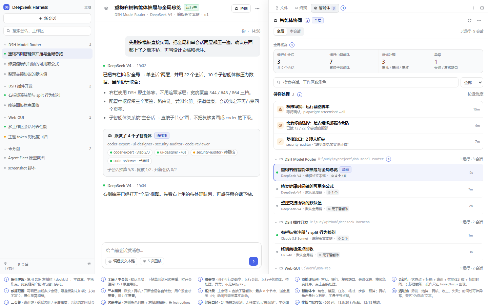
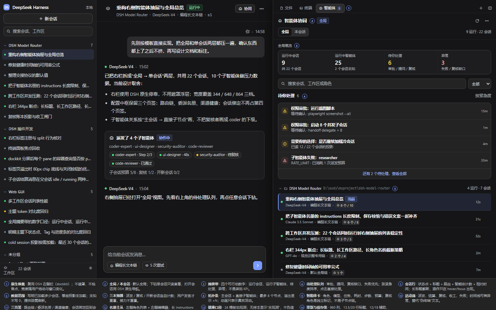
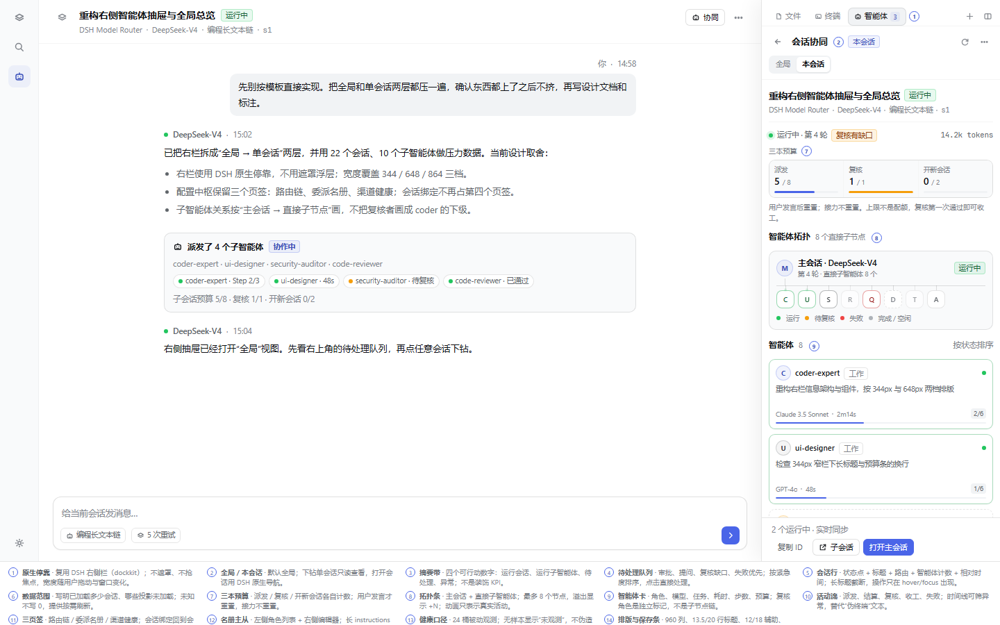

# Gemini 模板审查

## 摘要

`spike/nexus-super-plugin-preview.html` 是一份有用的**功能清单**：它把路由链、工牌名册、渠道健康、会话审计和右侧协作抽屉摆在了同一张图上，也证明“右栏看子智能体”这个方向是对的。

但它不是一份可实施的设计：**载体是 fixed 遮罩浮层而不是 DSH 原生右栏；只画单会话，没有全局；把复核者画成 coder 的下级；大量指标没有数据源；4 个页签把配置与运行混在一起；浅色主题下抽屉不可读；10 个子智能体就会把三张卡片的竖排结构撑成一条长墙。**

本文只记录“模板现在是什么、哪里不成立”。新设计见 [Agent Fleet 抽屉与三页签配置中枢](agent-fleet-drawer.md)，可交互原型见 [`docs/prototypes/agent-fleet.html`](../prototypes/agent-fleet.html)。

## 一、审查对象与方法

| 项 | 内容 |
|---|---|
| 对象 | Gemini 生成的 `nexus-super-plugin-preview.html`（已删除；本页只保留审查结论） |
| 方法 | 审查时读 HTML/CSS/JS 并在 1440×900 实拍；模板与截图不作为交付物保留 |
| 对照源码 | `D:\sudy\github\deepseek-harness`（只读） |

模板已从仓库移除，避免与当前设计并存造成混用。下面提到“模板”均指已删除的那份原型。

## 二、结论

**能用的部分**：功能盘点、右栏入口的产品直觉、三本预算（派发 / 复核 / 新会话）、24 桶健康时间轴、常驻保存条、“工牌”这个角色隐喻。

**不能用的部分**：载体、作用域、关系模型、数据口径、功能分配、主题系统、压力测试、交互细节。下面按 P0/P1 记。

## 三、结构性问题

### P0-1 载体错了：遮罩浮层不是 DSH 右栏

模板把抽屉做成 `position: fixed; right: 0; width: clamp(380px, 48vw, 720px)` 的浮层，再加一层 `background: rgba(0,0,0,.6); backdrop-filter: blur(4px)` 的全屏遮罩。后果是所有“边看边操作”的场景都不成立：遮罩挡住主界面，点击遮罩关闭抽屉，键盘焦点没有交给抽屉，滚动也没有锁。

DSH 当前右栏是**停靠列**，不是模态：

| 事实 | 源码 |
|---|---|
| 右栏默认 45% 视口宽，最小 300，最大 70%；中间列保底 400 | [`columns.ts:24-29`](file:///D:/sudy/github/deepseek-harness/packages/client/ui-layout/src/client/columns.ts#L24)、[`:52-58`](file:///D:/sudy/github/deepseek-harness/packages/client/ui-layout/src/client/columns.ts#L52) |
| 视口 < 768 时自动全屏；停靠态只在有足够空间时保留 | [`SidebarRight.tsx:360-370`](file:///D:/sudy/github/deepseek-harness/packages/client/ui-sidebar-right/src/client/shell/SidebarRight.tsx#L360) |
| 标签条高 28px，顶部再留 10px；正文由 dockkit 提供 | [`dockkit.module.css:237-248`](file:///D:/sudy/github/deepseek-harness/packages/client/ui-dockkit/src/components/dockkit.module.css#L237) |
| 打开标签会同步展开右栏 | [`service.ts:197-216`](file:///D:/sudy/github/deepseek-harness/packages/client/ui-sidebar-right/src/client/service.ts#L197) |
| 标签类型通过 `sidebarRightTabs.register` 注册，正文走 `sidebar.right.pane.tab` | [`tab-registry.ts:94-139`](file:///D:/sudy/github/deepseek-harness/packages/client/ui-sidebar-right/src/client/tab-registry.ts#L94)、[`index.ts:203-232`](file:///D:/sudy/github/deepseek-harness/packages/client/ui-sidebar-right/src/client/index.ts#L203) |
| 会话头已有原生展开按钮（`conversation.session.header.corner`） | [`index.ts:238-243`](file:///D:/sudy/github/deepseek-harness/packages/client/ui-sidebar-right/src/client/index.ts#L238) |

模板在页头又加了一个“展开右侧赛博大抽屉”按钮。DSH 已在会话头 `conversation.session.header.corner` 放了原生展开按钮；再加一个就是两个入口，且模板按钮只在这张 mock 页面里有意义。

量测对照（1440 / 1024 / 800 视口）：

| 视口 | 模板 | DSH 原生（左栏 280 或收起 56） |
|---|---|---|
| 1440 | 浮层约 48vw（≤720px）+ 全屏遮罩 | 648px 停靠，中间列 512px 仍可操作 |
| 1024 | 浮层约 492px + 全屏遮罩 | 约 344（左栏展开）或 461（左栏收起）；中间 400 / 507 |
| 800 | 浮层 384px + 全屏遮罩 | 344px 停靠（打开右栏时左栏自动收起），中间 400 |
| <768 | 仍是浮层 | 自动全屏，不再假装有停靠空间 |

**判断**：保留“右栏”这个产品位置，丢掉 `fixed + backdrop`。实现只能注册 dockkit 标签页；不要自建 `createPortal` 抽屉，也不要重复标签条的关闭/全屏按钮。

### P0-2 作用域错了：只有当前会话，没有全局

模板的抽屉标题是“当前会话赛博协同大盘”，内容只有一条 `Session: 793e664f · Turn 4`。它的“多会话切换”只存在于注释里，没有任何工作区/会话列表、全局摘要、待处理队列。

DSH 是多工作区、多会话并发的，右栏标签本身又是 **session scope**：每个前台会话有自己的标签布局。用户要的是“先看全局，再看单会话”，模板恰好相反，也少了一层。

### P0-3 关系错了：把复核者画成 coder 的下级

模板画的是 `主控脑 → coder-expert → security-auditor` 的纵向链，激光线从 coder 指向 auditor。DSH 的 `subagentCatalog` 是**父会话的直接子会话目录**；复核者也是主会话派出的子会话，不是 coder 的子会话（[`projection-types.ts:10-38`](file:///D:/sudy/github/deepseek-harness/packages/subagent/subagent/src/projection-types.ts#L10)）。复核是角色与动作（`role: review`、`finish{reviewId}`），不是父子关系。

模板的纵向“激光光纤”还掩盖了并发：多个子智能体可以同时跑，链路不是一条队列。新图必须画成 **主会话 → 直接子节点**，复核用角色标签/账本状态表达，不画成子链。

### P0-4 数据口径错了：指标是编的，且互相打架

模板里的这些数字没有来源或互相冲突：

- “全网平均可用率 99.92%”“平均首字响应 124ms”“162.4 t/s”“6 个渠道全部存活”。
- 第一跳“失败重试 5 次”本身不是错，但模板没有说明第一跳 = 会话选中的模型、白名单失败不重试；它又并列“重试 0 次（秒切）”，读者无法判断哪个是配置、哪个是状态。
- 抽屉“委派预算 1/5”、名册“单轮最大派发 5 次”、页面“候选 3”、会话页“首跳 5 次 / 候选 2 次”，四组数字不在同一个账本上；与 handoff 提案的 per-user 8 / per-turn 1 也不一致。
- “探活全部渠道”“强制熔断”“导出审计 JSON”都不是当前插件能力；模板用 `alert()` 假装它们已经能用。

DSH 当前能拿到的：`subagentCatalog`、`subagentTiming`、`tokenUsage`、`contextPressure`、`SessionStatus.pendingInteraction`、会话列表与工作区列表。拿不到的：插件级的 TTFT（`sessionStats` 属于 DSH 自己）、全局“存活率”、手动熔断、Nudge UI。新设计必须逐个标注“现有 / 需新增投影 / 无数据源不做”。

### P0-5 功能分配错了：4 个页签把配置和运行混在一起

模板的 4 个页签是：路由流水线、工牌名册与委派、健康与熔断大盘、会话透视与审计。问题不是数量，而是**时间尺度混了**：

- 配置是低频、写操作、需要空间；运行是高频、读操作、需要常驻。模板把两者都塞进主页面，又把名册和开关塞进抽屉。
- “会话透视”重复了会话输入框里已有的链绑定 chip；“故障转移历史”已有 Modal；单独一个页签只增加导航成本。
- 名册用卡片，`purpose` 一两行还能看，`instructions` 是 4000 字符级文本，卡片必然截断。模板确实截断了，编辑入口是 `href="#"`；页签写“4 岗位”，页面只有 2 张卡，扩容路径不存在。
- 名册只展示 `purpose`/`instructions` 两段和三个预算数字，没有 `outputSchema`、协议动作、`newSession.nextAction`、兜底角色；这不是“功能多到放不下”，是功能盘点不完整。
- 健康页的 24 柱没有桶长、没有图例、没有样本量；“99.9%”放在页签上，用户无法知道它统计什么。

### P0-6 主题与视觉语言错了：浅色主题下抽屉不可读

模板的抽屉写死 `background: rgb(15, 17, 24)`、霓虹青/紫、硬编码 `rgba` 边框；主题切换只改 `body[data-theme]` 的 token 变量，抽屉不跟随。实拍浅色主题：抽屉仍是深色底，文字却切到浅色主题的深色 label，几乎不可读。

同时，模板大量使用 emoji 作为图标（🛡️、🤖、⚡、🪪、📊、🧭、👨‍✈️、🧑‍💻、🧐），不同平台字形/宽度不一致；在 10.5px 的密度下更明显。DSH 原语是 15–16px 的线性 SVG，不走 emoji。

### P1-1 密度与压力：三张卡片掩盖了所有问题

模板抽屉的“纵向阶梯”是 3 张 `cyber-tile` + 2 条 28px 的激光线。这个规模下当然不挤；但 10 个子智能体时：

- 每张卡约 120–160px，10 张就是 1200–1600px；两条装饰线只是把长度再加 56px。
- 没有折叠、没有分组、没有“仅看运行”、没有溢出计数、没有虚拟滚动。
- 720px 宽下每卡一行终端文本；344px 下会怎样，模板没有测过（它没有 `@media`、没有 `@container`，只有 `clamp` 宽度）。
- 顶栏在 1024 还能塞下 4 个页签，但 800 视口与 344px 抽屉内容没有策略：`.header-main-row` 允许 `flex-wrap`，页签却不折行，也没有横向滚动。

### P1-2 交互与可访问性：mock 的边界没有标出来

- 11 处 `alert()` 冒充交互；`href="#"` 的“编辑工牌”会跳回页顶。
- 没有 `role="tab"` / `aria-selected` / 方向键；页签是普通 `button` + `onclick`。
- 没有焦点圈禁/归还；遮罩打开时，Tab 仍能走到背后的主界面。
- 没有 `prefers-reduced-motion`；所有霓虹脉冲/激光动画持续运行。
- 有 `
` 这类无效 CSS 属性（应为 `padding-top`），浏览器直接忽略。
- 10.5px 用于关键元数据（会话 id、激光标签），在 344px 宽度下已经不是“紧凑”，而是难读。

## 四、可以保留的部分

| 保留 | 理由 | 落到新设计 |
|---|---|---|
| 右栏看协同 | 用户的核心诉求；不打断主对话 | DSH dockkit 标签页，不是浮层 |
| 功能清单 | 4 个领域一个不少 | 3 个配置页签 + 1 个运行抽屉 |
| 三本预算 | 派发 / 复核 / 新会话是真实收敛机制 | 单会话抽屉顶部三格 |
| 24 桶时间轴 | 与当前健康投影的桶模型一致 | 健康页保留，补桶长/图例/样本量 |
| 常驻保存条 | 与当前工作台一致 | 保留，吸底 |
| “工牌”隐喻 | 用户能记住；purpose/instructions 两个读者 | 名册列表 + 编辑器，不再用卡片墙 |

## 五、量测对照：模板 vs 新设计

| 维度 | 模板 | 新设计 |
|---|---|---|
| 载体 | `fixed` 浮层 + 全屏遮罩 | `sidebarRightTabs` + `sidebar.right.pane.tab` |
| 作用域 | 当前会话 | 全局默认；可下钻任意会话（只读） |
| 宽度 | `clamp(380,48vw,720)`，不受 DSH 列约束 | 原生 300–70%，默认 45%；<768 自动全屏 |
| 关系图 | 主控 → coder → auditor 纵链 | 主会话 → 直接子节点；复核是角色/账本 |
| 密度 | 3 张大卡 + 激光线 | 摘要 + 队列 + 分组列表；会话内拓扑条 + 卡片网格 + 活动流 |
| 主题 | 硬编码深色/霓虹 | 只用 DSH token；明暗同源 |
| 数据 | 编造、互斥 | 每格标“现有 / 需新增 / 不做” |
| 状态 | 无空/错/未知 | 空、错误、未知、部分加载、无匹配 |
| 可访问性 | alerts、无 aria、无 reduced motion | 原生 tabs/按钮、键盘、状态文字、reduced motion |
| 压力 | 3 个智能体 | 22 会话 / 12 角色 / 10 子智能体 |

新设计的实拍（同尺寸、同明暗）：

## 六、实施时最容易绕路的五个点

1. **不要自建抽屉。** 先去读 `sidebarRightTabs.register` 与 `sidebar.right.pane.tab`；注册类型和正文是两步，不是二选一。
2. **不要把“本会话”当成“全局”。** 右栏 store 是按 session 的；全局视图必须读 `sessions.list` + `workspaces`，不能只读当前 `useProjection`。
3. **不要把 catalog 的 `parentId` 当成“谁派了谁”的完整真相。** catalog 只有直接子节点；更深层要逐层加载，加载不到就写“未加载”。
4. **不要从缺失的投影推断 0。** `projectionsBySession[id]` 没有 `subagentCatalog` 是“未知”，不是“没有子智能体”。先 `refreshProjections(id)`。
5. **不要为了让图“动起来”而给每张卡加呼吸。** 动画只表示当前活动；否则 22 个会话同时在跑时，右栏会变成一片闪烁。

## 七、参考

**DSH 源码（只读 checkout）**

- 右栏标签注册与正文席位：[`tab-registry.ts:94-139`](file:///D:/sudy/github/deepseek-harness/packages/client/ui-sidebar-right/src/client/tab-registry.ts#L94)、[`contract/slots.ts:41-104`](file:///D:/sudy/github/deepseek-harness/packages/client/ui-sidebar-right/src/client/contract/slots.ts#L41)
- 右栏列宽与中间列保底：[`columns.ts:11-29`](file:///D:/sudy/github/deepseek-harness/packages/client/ui-layout/src/client/columns.ts#L11)
- 自动全屏阈值：[`SidebarRight.tsx:360-370`](file:///D:/sudy/github/deepseek-harness/packages/client/ui-sidebar-right/src/client/shell/SidebarRight.tsx#L360)
- 标签条尺寸：[`dockkit.module.css:237-248`](file:///D:/sudy/github/deepseek-harness/packages/client/ui-dockkit/src/components/dockkit.module.css#L237)
- 子智能体目录/时序：[`projection-types.ts:10-38`](file:///D:/sudy/github/deepseek-harness/packages/subagent/subagent/src/projection-types.ts#L10)
- 会话列表与投影提示：[`service.ts:27-66`](file:///D:/sudy/github/deepseek-harness/packages/api/session-controller/src/client/sessions/service.ts#L27)
- 工作区会话树与运行中子智能体计数：[`tree.ts:390-418`](file:///D:/sudy/github/deepseek-harness/packages/client/ui-workspace/src/client/tree.ts#L390)
- 侧栏打开子会话：[`ui-subagent/src/client/index.ts:60-72`](file:///D:/sudy/github/deepseek-harness/packages/client/ui-subagent/src/client/index.ts#L60)

**外部官方参考**

- VS Code Secondary Side Bar：[User Interface](https://code.visualstudio.com/docs/editing/getting-started/userinterface)（右栏/主栏并存的布局先例）
- GitHub Actions 可视化图：[Using the visualization graph](https://docs.github.com/en/actions/how-tos/monitor-workflows/use-the-visualization-graph)（节点状态与运行图）
- OpenAI Agents SDK Handoffs：[Handoffs](https://openai.github.io/openai-agents-python/handoffs/)（把“交接”说成一个有明确接收者的动作）
- Claude Code 并行 agent：[Run agents in parallel](https://code.claude.com/docs/en/agents)（并发子任务的心智模型）
- OpenTelemetry Traces：[Traces](https://opentelemetry.io/docs/concepts/signals/traces/)（时间线/跨度的通用表示）
